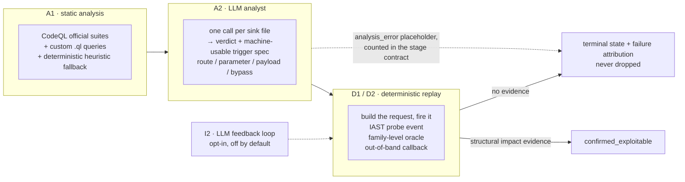

<div align="center">

# SAVR

**S**can · **A**nalyze · **V**erify · **R**eplay

An automated white-box vulnerability scanning and verification pipeline: static analysis
produces candidate findings, and a local LLM returns a verdict plus a machine-usable trigger spec;
deterministic replay fires that spec at a running target, and a finding counts as confirmed
only on structured impact evidence. The LLM never touches the target; everything downstream
is deterministic, replayable and auditable.

[](https://github.com/sanjio3/SAVR/actions/workflows/ci.yml)
[](LICENSE)
[](pyproject.toml)
[](probe-java/)

[Releases](https://github.com/sanjio3/SAVR/releases) · [Issues](https://github.com/sanjio3/SAVR/issues) ·
[Security](SECURITY.md) · [Contributing](CONTRIBUTING.md)

English | [中文](README_zh.md)

</div>

---

## The problem

A static analyzer gives you a list. Some entries are real, some are not, and nothing in the
report tells you which. A dynamic scanner gives you coverage of URLs you already know how to
reach, and nothing about the sinks you never guessed. Both halves are cheap to produce and
expensive to trust.

SAVR connects them. Static analysis proposes candidates. A local LLM reads each sink file and
writes a concrete trigger spec — which route, which parameter, which payload, which bypass. A
deterministic replayer then fires that spec at a running target and looks for structural
evidence of impact.

**The LLM never touches the target.** It judges and it writes specs; that is the whole of its
authority. Everything downstream is deterministic, replayable and auditable, which is what
makes a confirmation mean something.

---

## How a scan works



- A1 runs CodeQL official suites plus custom queries for shapes the official queries do not
  model (`prepareCall`, Spring `JdbcTemplate`, weak hash algorithms), with a deterministic
  heuristic fallback so a failed CodeQL build never silently produces an empty report.
- A2 makes one LLM call per sink file and returns both a verdict and a machine-usable trigger
  spec, JSON-validated with one repair round. A file that fails is recorded as an
  `analysis_error` placeholder and counted in the stage contract; it is never dropped, because
  a dropped file is indistinguishable from a clean file in the final report.
- D1/D2 replay the specs. Confirmation requires structured impact evidence: a probe event at
  the sink, a family oracle (SQL boolean pairs, path traversal file signatures, expression
  evaluation, reflection), or an out-of-band callback. "Reached the sink" and "the model says
  it is harmful" are each insufficient on their own.
- Unconfirmed candidates keep a terminal state and a failure attribution, so a missed
  vulnerability can be told apart from a target that was down, an endpoint that 404s, or a
  payload that never arrived.
- Deterministic retries are always on. I2, an LLM feedback loop that re-judges based on
  replay diffs, is opt-in (`SAST_AI_CLOSED_LOOP=1`) and has not shown a measured gain in our
  testing.

Where the time goes, measured on our own runs: on a 95-file Java target, replay and target
round-trips took 45% of recorded stage time, the LLM stage 26%, deterministic re-runs 25% and
static analysis 2%. On a 130-case benchmark shard it was 46% / 18% / 16% / 17%. The dominant
cost is hitting the target, not inference.

---

## Results

Three evaluation sets are reported. They use different accounting and must not be combined
into a single score. The numbers describe one conformance run on the reference targets, not a
target-independent guarantee.

### Java target, four-tier accounting

A full re-scan of a public Java vulnerability test application (31 in-scope truth points). The
dynamic denominator is 24 points: 31 minus 4 physically unreachable endpoints and 3
property/configuration families that cannot be proven by sending a payload.

`confirmed_replay` requires `verification_status == confirmed_exploitable`, an evidence rule
without the `framework:` prefix, and at least one row in `replay_attempts` for that spec.

| Run | What differs | Static (file) | Static (file+family) | Replay (file+family) | Red-line FP |
|---|---|---|---|---|---|
| Baseline | frozen build, full re-scan | 31/31 | 30/31 | 24/24 | 0/65 |
| Route-blinded | route names and dispatch targets rewritten | 30/31 | 29/31 | 21/24 (87.5%) | 0/40 |
| Stability A | identical config, second run | 31/31 | 30/31 | 24/24 | 1/62 |
| Stability B | identical config, third run | 31/31 | 30/31 | 23/24 (95.8%) | 0/62 |

- Stability is measured, not assumed. Two runs of the same frozen source with identical
  configuration produced 24/24 and 23/24 — a one-point swing. The point that moved is an SSTI
  case whose late value-level evidence arrived in one run and not the other. Do not quote this
  as "stable at 100%".
- Blinding route names costs 4 points of static file+family recall and 12.5 points of replay
  recall. That gap is the measured value of knowing what the routes are called; it is the
  reason route-name heuristics are treated as a prior rather than as evidence.
- The single red line in Stability A is a real reflected XSS that the shipped truth table does
  not register for that file. We chose to disclose it rather than edit the truth table to
  absorb it. Under the looser pre-2026 definition the route-blinded run also reads 1 red line;
  tightening the definition (requiring an actual replay attempt) is what moved it to 0, not a
  fix, and we report it that way.
- Static file+family is 30/31 in the three unblinded runs — the same point every time, which
  is a known coverage gap, not run-to-run noise.

Recompute with your own scan database:

```bash
python tools/jsc_four_tier.py --task-id <id> --verbose
python tools/jsc_four_tier.py --task-id <id> --param-drift
python tools/generalization_compare.py --mode stability --baseline <id1> --variant <id2>
```

### Cross-target baseline (RuoYi 4.5.1)

A separate truth table (15 rows, 6 in scope) on a different framework and codebase. Static 4/4
by point (6/6 by row), dynamic 4/4 (6/6), runtime replay 2/4 (2/6), red-line FP 0/2,
confirmed-level FP 0/7. Of the four unconfirmed points, three are MyBatis `${}` confirmed as a
static code property where the boolean-blind oracle condition did not hold, and one reached the
sink but was not judged harmful. None of the four is a detection miss.

This run builds a baseline only. It is not scored against the Java target's 24-point
denominator, because the two truth tables have different sizes and different families.

### OWASP Benchmark, 130-case shard

79 true positives and 51 false positives, matched case-by-case against the official
`expectedresults-1.2.csv`.

Two accountings exist for this benchmark and they are not interchangeable. Earlier work used
confirmation-state accounting before the strict replay definition existed, and those figures
depend on route-layout priors. They are kept only because the gap between them is informative:

| Accounting | TP | FP | Recall | Precision |
|---|---|---|---|---|
| Earlier accounting, normal layout, layout prior on | 78 | 0 | 98.7% | 100% |
| Earlier accounting, layout obfuscated, layout prior off | 71 | 0 | 89.9% | 100% |

The 8.9pp gap is the measured dependency on URL layout knowledge: 2740 routes were renamed and
dispatch targets rewritten to produce the second row. Both rows predate the strict replay
definition and are not comparable with the figure below.

The current reading on the same 130 cases: 59 confirmed cases, 59 TP, 0 FP, 100% precision,
74.7% recall, red-line FP 0/34.

Zero false confirmations plus 74.7% recall is the honest summary. It is not "fully detected".
The 20 missed true positives break down as 15 weak-randomness, 2 weak-hash, 2 SQL injection and
1 weak-crypto. Weak randomness is 0/15 confirmed as an entire family: those are real defects,
the scanner detects them, and the confirmation stage cannot currently prove them, because their
specs are labelled `xss` and routed into the XSS verdict channel. See Known limitations.

A passing red line means "we did not confirm a false vulnerability". It does not mean "we found
everything".

---

## Requirements

- Python 3.12 or newer.
- Node.js 20 or newer, for the frontend.
- JDK 11 or newer and Maven, to build the IAST probe (it is built, not shipped).
- CodeQL CLI, for the static analysis stage. `uv run python scripts/fetch_tools.py --dest tools
  --only codeql` downloads the bundle into `tools/codeql/`; alternatively set `CODEQL_BIN` or put
  `codeql` on `PATH`. The bundle is about 1GB and is not vendored.
- A running HTTP target with the bundled IAST java agent attached. Target applications, JDKs,
  Tomcat and third-party binaries are not vendored; you supply your own.
- An LLM endpoint. Any OpenAI-compatible local server works; the defaults point at Ollama.

Windows is the primary development platform. Linux and macOS should work but are untested.

---

## Install

```bash
git clone https://github.com/sanjio3/SAVR.git && cd SAVR
uv sync --frozen --group dev
cp .env.example .env
uv run python scripts/fetch_tools.py --dest tools --only codeql
ollama pull qwen3:8b
```

`uv.lock` pins every dependency and `pyproject.toml` is the canonical declaration. The repository
root is the import root, so no package installation step is needed. `uv run` is the supported
entry point for every command in this document; a virtualenv on `PATH` works as well.

The backend listens on `127.0.0.1:8000`. The frontend runs separately:
`cd frontend && npm ci && npm run dev`, listening on `127.0.0.1:5173`.

---

## First run

### Build the probe

The IAST probe is built, not shipped. It needs JDK 11 and Maven:

```bash
mvn -B -DskipTests -f probe-java/pom.xml clean package
```

This produces `probe-java/target/sec-probe.jar`. A companion `sec-probe-bootstrap.jar` is
generated by the same build and has to ship alongside it. The probe must be attached before the
target JVM starts, on both the bootstrap class path and as an agent; the launchers under
`scripts/launch/` do this and are the reference for the exact flags. If the jar is missing, those
launchers fall back to an external path and your target will run without instrumentation — no
events, and no error to tell you so.

### Targets and launchers

Scan targets are external projects. None of their source is vendored here, so the launchers
take their location from the environment:

| Launcher | Target | Environment variable |
| --- | --- | --- |
| `scripts/launch/launch_java_seccode.py` | java-sec-code | `SAST_AI_SECCODE_DIR` |
| `scripts/launch/launch_owasp.py` | OWASP Benchmark sample (200 cases) | `SAST_AI_OWASP_DIR` |
| `scripts/launch/launch_owasp_full.py` | OWASP Benchmark full | `SAST_AI_OWASP_FULL_DIR` |
| `scripts/launch/launch_target_mall.py` | target-mall | `SAST_AI_TARGET_MALL_DIR` |

Unset, they fall back to a directory of the same name next to the repository. The probe jar
comes from the in-repo build (`probe-java/target/sec-probe.jar`) unless `SAST_AI_PROBE_JAR`
points elsewhere. `scripts/launch/launch_java_quote.py` is a minimal example of attaching the
probe to any JVM target, and is the reference when you write your own launcher.

Two more environment variables are worth knowing: `SAST_AI_HSQLDB_JAVA` selects the JDK the
OWASP launchers use for the HSQLDB server, and `SAST_AI_TOOLS_DIR` points at the directory
`scripts/fetch_tools.py` populated.

The RuoYi launcher is not distributed: it expects a specific JDK 8, a local MySQL and a local
RuoYi checkout, so it stays a local script. Attach the probe the way `launch_java_quote.py`
does.

### Submit a scan

Register a workspace pointing at your target, attach the probe, and submit a task through the
API or the UI. A CLI entry point exists for debugging:

```bash
python -m src.cli.scan_task_runner --task-id 1 --target /path/to/target/src \
  --output-dir output/run1 --shard-file data/owasp_shards/shards/mini.json --no-sca
```

Before pointing a run at an external target, check that the probe session and token actually
match. When they do not, the ingest endpoint answers HTTP 200 with `accepted=0`, which is easy
to misread as success:

```bash
python tools/probe_preflight.py --workspace-id 4 --http
```

`ready=true` means the session row exists, the heartbeat is fresh, and a handshake carrying
`X-Agent-Token` was accepted with a non-empty `session_id` and no `errors`. The check writes no
events and does not refresh the heartbeat, so it cannot make a dead session look alive.

---

## Configuration

Configuration is environment-first. `.env.example` lists the core runtime keys with their
defaults; model hyperparameters live in `config/model_capabilities.yaml`.

To choose a model:

1. `cp config/config.example.yaml config.yaml`. The copy is gitignored because it may hold
   credentials.
2. Set `api.provider` and `api.model` to one of the sections in that file: `ollama` (default, no
   key required), `qwen`, `doubao`, `minimax`, `deepseek`, `openai-compatible`, `claude`, or
   `anthropic-compatible`.
3. Fill that section. The local `ollama` section needs `base_url` and `model`; cloud sections
   need `base_url`, `api_key` and `model`. Any value may be written as `"${ENV_VAR}"` so the
   secret stays in the environment.

Environment variables keep the `SAST_AI_` prefix from the project's earlier name. That prefix
is part of the run contract — two of the six baseline `run_env` keys are spelled with it — so it
is deliberately left unchanged for backwards compatibility.

### Keys that change whether a run is valid

- `SAST_AI_STAGE_CACHE=0` for a measured run. Otherwise cached A1/A2 output masks run-to-run
  variation. Code default is `1`, so this must be explicit.
- `SAST_AI_CLOSED_LOOP=0` unless you specifically want the I2 feedback loop. It has no measured
  gain and it adds an LLM dependency to the confirmation path.
- `SAST_AI_BENCHMARK_PRIOR=1` keeps the route-layout prior on. Turning it off is the experiment
  that measures how much of the recall depends on knowing the route names.

---

## Repository layout

```
SAVR/
├── src/                     # backend: agents, pipelines, IAST bridge, CLI
│   ├── agents/              # A1 static, A2 LLM analyst, D2 executor
│   ├── pipeline/            # a1 / a2 / d2 stage contracts
│   ├── iast/                # probe ingest, coverage, oracles
│   ├── core/                # shared primitives: config, families, stage cache
│   └── cli/                 # service server, scan task runner, benchmark CLI
├── probe-java/              # the IAST/RASP agent (Java, ByteBuddy) — built, not shipped
├── frontend/                # Vue 3 + Vite control panel
├── tools/                   # reconciliation, shards, evaluation harness, one-off scripts
├── scripts/                 # entry points: fetch_tools, submit_scan_task, launch/
├── config/                  # committed, credential-free configuration
├── data/                    # reference truth tables and a shard manifest
├── tests/                   # unit and regression suite
└── .github/workflows/       # ci (3 required checks) and benchmark
```

---

## Reporting issues

Run these two checks before filing; they resolve a large share of reports:

1. `python tools/probe_preflight.py --workspace-id <id> --http` — if this is not `ready=true`,
   events are being dropped at ingest and every replay will look like a miss.
2. `uv run --frozen python tools/ci_gate.py` — confirms the failure is not a local environment problem.

When you open an issue, include:

- What you expected and what happened, in one or two sentences.
- The model and provider (`qwen3:8b` via Ollama, or the endpoint you used), the target
  application and how its probe is attached, and the `run_env` keys you set.
- The task's terminal `verification_status` and `failure_attribution` for the spec in question,
  plus `stage_results.a2.contract` if the LLM stage is involved. These three fields explain most
  misses without needing source access.
- Relevant log lines, not full logs.

Reports of particular value:

- A real-world target that exposes a false confirmation.
- A detected defect that cannot be confirmed, with the spec terminal state attached.
- A reproducible divergence between two runs of the same target.

Do not open a public issue for a vulnerability in this project. Use GitHub's private
vulnerability reporting (Security → Report a vulnerability) instead.

---

## License

Apache License 2.0. The full text is in [LICENSE](LICENSE); attribution notices for third-party
components are in [NOTICE](NOTICE).

The licence permits use, modification and redistribution, including within closed-source
products, provided that copyright and licence notices are retained, modifications are stated,
and the project name or contributors' names are not used to endorse derived work. It includes
an express patent grant from contributors.

The permissive choice is deliberate: the tool is intended to be embedded in existing security
pipelines rather than used standalone.
