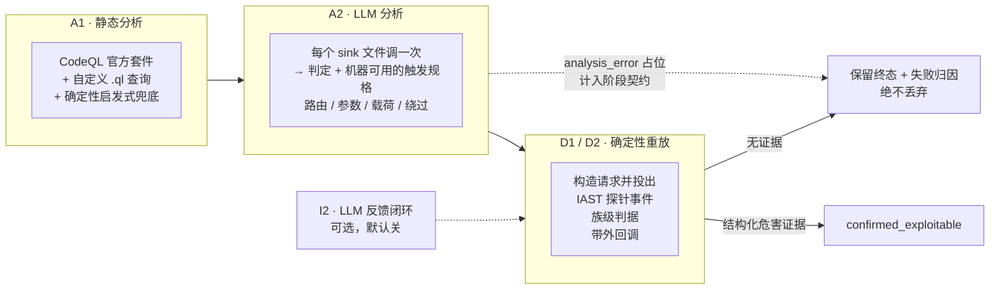

<div align="center">

# SAVR

**S**can · **A**nalyze · **V**erify · **R**eplay（扫描 · 分析 · 验证 · 重放）

自动化白盒漏洞扫描与验证流水线：静态分析产生候选告警，大模型给出研判与机器可用的触发规格；
确定性重放对运行中的目标发起验证，告警是否成立仅由结构化危害证据判定。
模型不接触目标，验证过程确定、可复现、可审计。

[](https://github.com/sanjio3/SAVR/actions/workflows/ci.yml)
[](LICENSE)
[](pyproject.toml)
[](probe-java/)

[Releases](https://github.com/sanjio3/SAVR/releases) · [Issues](https://github.com/sanjio3/SAVR/issues) ·
[安全](SECURITY.md) · [贡献](CONTRIBUTING_zh.md)

[English](README.md) | 中文

</div>

---

## 这个项目解决什么问题

静态分析给你一张清单。清单里有真漏洞也有假的，而报告本身不告诉你哪条是哪条。动态扫描器能覆盖你已经知道怎么访问的 URL，却覆盖不到你根本没想到的 sink。两边都便宜，都可信度低。

SAVR 把两端接起来。静态分析提出候选，本地 LLM 读每个 sink 文件并写出一份具体的触发规格：打哪条路由、传哪个参数、用什么载荷、绕什么拦截。然后由确定性重放器把这份规格打到运行中的靶场上，寻找结构化的危害证据：进程内 IAST 探针在 sink 上的事件、族级响应判据，或带外回调。

**LLM 永远不碰靶场。** 它只做判定和写规格，这就是它全部的权限。下游一切都是确定性的、可重放、可审计的——这正是「确认」两个字有意义的原因。

---

## 扫描流程



- A1 跑 CodeQL 官方套件，加上针对官方查询不建模形态的自定义查询（`prepareCall`、Spring `JdbcTemplate`、弱哈希算法），并带一条确定性的启发式兜底，保证 CodeQL 建库失败不会静默产出一份空报告。
- A2 每个 sink 文件调一次 LLM，同时返回判定和机器可用的触发规格，经 JSON 校验并带一轮修复。失败的文件记为 `analysis_error` 占位并在阶段契约里计数，绝不丢弃——因为被丢掉的文件和本来就干净的文件，在最终报告里长得一模一样。
- D1/D2 执行重放。确认必须有结构化危害证据：sink 上的探针事件、族级判据（SQL 布尔对、路径穿越文件特征、表达式求值、反射），或带外回调。「到达 sink」和「模型说有害」这两者本身都不够。
- 未确认的候选保留终态与失败归因，因此「漏了一个漏洞」和「靶场挂了」「端点在 404」「载荷没送到」可以区分开。
- 确定性重跑始终开启。I2 是一个根据重放差分重新判定的 LLM 反馈闭环，需要显式开启（`SAST_AI_CLOSED_LOOP=1`），在我们的测试中未出现过增益。

时间花在哪里，是我们自己实测的：95 个文件的 Java 靶场上，重放与靶场往返占记录阶段时间的 45%，LLM 阶段 26%，确定性重跑 25%，静态分析 2%。130 例基准分片上分别是 46% / 18% / 16% / 17%。主要成本是打靶场，不是推理。

---

## 检测效果

报告三套评测集。它们的记账口径不同，不能合并成一个分数。下面每个数字都可以用 `data/` 里随仓库分发的真值表和分片定义，加上你自己跑出来的扫描数据库复算。

### Java 靶场，四档口径

对一个公开的 Java 漏洞测试应用做全量重扫（31 个 in_scope 真值点）。动态分母是 24 个点：31 减去 4 个物理不可达端点，再减去 3 个无法靠投载荷证明的属性/配置族。

`confirmed_replay` 要求 `verification_status == confirmed_exploitable`、证据规则不带 `framework:` 前缀、且该规格在 `replay_attempts` 里至少有一行。

| 轮次 | 差异 | 静态（文件级） | 静态（文件+族） | 重放（文件+族） | 红线误报 |
|---|---|---|---|---|---|
| 基线 | 冻结构建，全量重扫 | 31/31 | 30/31 | 24/24 | 0/65 |
| 路由盲化 | 路由名与分发目标重写 | 30/31 | 29/31 | 21/24（87.5%） | 0/40 |
| 稳定性 A | 相同配置，第二次运行 | 31/31 | 30/31 | 24/24 | 1/62 |
| 稳定性 B | 相同配置，第三次运行 | 31/31 | 30/31 | 23/24（95.8%） | 0/62 |

- 稳定性是量出来的，不是假设的。同一份冻结源码、相同配置连跑两次，得到 24/24 和 23/24，一个点的抖动。变动的那一点是一个 SSTI 用例，它的迟到值级证据一次运行来了、一次没来。不要把它写成「稳定在 100%」。
- 盲化路由名要付出 4 个点的静态文件+族召回和 12.5 个点的重放召回。这个差距就是「知道路由叫什么」的实测价值，也是我们把路由名启发式当作先验而不是证据的原因。
- 稳定性 A 里那一条红线，是一个真实的反射 XSS，只是随仓库分发的真值表没有为那个文件登记。我们选择如实披露，而不是改真值表把它吸收掉。按 2026 年之前更宽松的定义，路由盲化那轮也会读出 1 条红线；是收紧定义（要求真有一次重放尝试）让它变成 0 的，这不是修复，我们就是这么标注的。
- 三轮未盲化的运行里，静态文件+族都是 30/31，缺的始终是同一个点。那是已知的覆盖缺口，不是轮次间噪声。

用你自己的扫描数据库复算：

```bash
python tools/jsc_four_tier.py --task-id <id> --verbose
python tools/jsc_four_tier.py --task-id <id> --param-drift
python tools/generalization_compare.py --mode stability --baseline <id1> --variant <id2>
```

### 跨靶场基线（RuoYi 4.5.1）

另一套真值表（15 行，6 行 in_scope），另一个框架和另一份代码。静态 4/4（按行 6/6）、动态 4/4（6/6）、运行时重放 2/4（2/6）、红线误报 0/2、确认级误报 0/7。四个未确认点里，三个是 MyBatis `${}` 已按静态代码属性确认、但布尔盲注判据条件不成立，一个是到达 sink 但没判出危害。这四个没有一个是漏检。

这一轮只建基线，不与 Java 靶场的 24 点分母比大小，因为两张真值表的规模和族都不同。

### OWASP Benchmark，130 例分片

79 个真阳性、51 个假阳性，按用例逐条对齐官方 `expectedresults-1.2.csv`。

这个基准存在两套口径，不可互换。早期工作用的是严格重放定义出现之前的确认态记账，那些数字依赖路由布局先验。保留它们只是因为两者之间的差距有信息量：

| 口径 | TP | FP | 召回 | 精确率 |
|---|---|---|---|---|
| 早期口径，常规布局，布局先验开 | 78 | 0 | 98.7% | 100% |
| 早期口径，布局盲化，布局先验关 | 71 | 0 | 89.9% | 100% |

那 8.9 个百分点就是对 URL 布局知识的实测依赖度：产出第二行时重命名了 2740 条路由并重写了分发目标。两行都早于严格重放定义，与下面的数字不可比。

同样 130 例上的当前读数：确认 59 个用例，59 TP、0 FP、精确率 100%、召回 74.7%、红线误报 0/34。

零假确认加 74.7% 召回，才是诚实的总结。它不是「全部检出」。漏掉的 20 个真阳性拆开是弱随机 15、弱哈希 2、SQL 注入 2、弱加密 1。其中弱随机整族 0/15：那些是真实缺陷，扫描器也检出了，但确认阶段目前证明不了，因为它们的规格被标成 `xss` 并被路由进 XSS 判决通道。详见下面「现在不足」。

红线通过的意思是「我们没有把假漏洞确认为真漏洞」。它不意味着「我们把所有漏洞都找出来了」。

---

## 环境要求

- Python 3.12+
- Node.js 20+（前端）
- JDK 11+ 与 Maven（构建 IAST 探针；探针是构建产物，不随仓库分发）
- CodeQL CLI 在 `PATH` 上（静态分析阶段用）
- 本地 LLM，由 Ollama 提供（默认 `qwen3:8b`），或任何 OpenAI 兼容端点
- 一个运行中的 HTTP 靶场，并挂载本项目自带的 IAST java agent。靶场应用、JDK、Tomcat 与第三方二进制不在本仓库内分发，需要你自己提供

主开发平台是 Windows。Linux 与 macOS 理论可用但未实测。

---

## 安装

```bash
git clone https://github.com/sanjio3/SAVR.git && cd SAVR
python -m venv .venv
.venv/Scripts/python.exe -m pip install -r requirements.txt
cp .env.example .env
python scripts/fetch_tools.py --dest /opt/sast-ai-tools
ollama pull qwen3:8b
python -m src.cli.service_server
```

Linux 或 macOS 用 `.venv/bin/python` 代替 `.venv/Scripts/python.exe`，并把 `SAST_AI_TOOLS_DIR` 指到传给 `fetch_tools.py --dest` 的目录。后端监听 `127.0.0.1:8000`。前端单独跑：`cd frontend && npm ci && npm run dev`，监听 `127.0.0.1:5173`。

`requirements.txt` 是依赖清单的兼容导出，`pyproject.toml` 是权威来源，`uv.lock` 锁定精确版本。仓库根目录就是导入根，所以装好依赖列表就够跑 CLI，不需要安装成包。`pyproject.toml` 里声明了 PEP 517 构建后端，供需要它的工具链使用，`uv sync` 配合 `[tool.uv] package = false` 也可用。`pip install -e .` 需要 `setuptools>=68`，pip 会把它拉进隔离构建环境；离线机器请用 `requirements.txt` 那条路。

---

## 第一次运行

### 构建探针

IAST 探针是构建产物，不随仓库分发。需要 JDK 11 与 Maven：

```bash
mvn -B -DskipTests -f probe-java/pom.xml clean package
```

产物是 `probe-java/target/sec-probe.jar`。同一次构建还会生成配套的 `sec-probe-bootstrap.jar`，两个必须一起带上。探针必须在靶场 JVM 启动前挂上，而且要同时挂到 bootstrap 类路径和 agent 位置；`scripts/launch/` 下的启动脚本就是这么做的，具体参数以它们为准。jar 缺失时，那些脚本会回退到一个外部路径，靶场会不带插桩地跑起来——没有事件，也不会报错告诉你。

### 靶场与启动脚本

靶场是外部项目，本仓库不分发它们的源码，所以启动脚本从环境变量读靶场位置：

| 启动脚本 | 靶场 | 环境变量 |
| --- | --- | --- |
| `scripts/launch/launch_java_seccode.py` | java-sec-code | `SAST_AI_SECCODE_DIR` |
| `scripts/launch/launch_owasp.py` | OWASP Benchmark 抽样版（200 例） | `SAST_AI_OWASP_DIR` |
| `scripts/launch/launch_owasp_full.py` | OWASP Benchmark 全集 | `SAST_AI_OWASP_FULL_DIR` |
| `scripts/launch/launch_target_mall.py` | target-mall | `SAST_AI_TARGET_MALL_DIR` |

不设时回退到「与本仓库同级、同名目录」的约定。探针 jar 默认取仓库内构建产物 `probe-java/target/sec-probe.jar`，`SAST_AI_PROBE_JAR` 可以改写。`scripts/launch/launch_java_quote.py` 是「如何把探针挂到任意 JVM 靶场」的最小示例，自己写启动脚本时以它为准。

另有两个环境变量值得知道：`SAST_AI_HSQLDB_JAVA` 指定 OWASP 脚本起 HSQLDB 服务用的 JDK，`SAST_AI_TOOLS_DIR` 指向 `scripts/fetch_tools.py` 下载工具的目录。

RuoYi 的启动脚本不分发：它依赖特定 JDK 8、本机 MySQL 和本地 RuoYi 源码，属于本地脚本。自己接靶场时按 `launch_java_quote.py` 的方式挂探针即可。

### 提交一次扫描

注册一个指向靶场的工作区、挂上探针，通过 API 或界面提交任务。调试用的 CLI 入口是：

```bash
python -m src.cli.scan_task_runner --task-id 1 --target /path/to/target/src \
  --output-dir output/run1 --shard-file data/owasp_shards/shards/mini.json --no-sca
```

在把一轮指向外部靶场之前，先确认探针会话与 token 确实对得上。对不上时，摄取接口会返回 HTTP 200 且 `accepted=0`，很容易被误读成成功：

```bash
python tools/probe_preflight.py --workspace-id 4 --http
```

`ready=true` 表示会话行存在、心跳新鲜，且带 `X-Agent-Token` 的握手被接受并返回了非空 `session_id` 且无 `errors`。这个检查不写任何事件，也不刷新心跳，所以它不会把已经死掉的心跳弄成活着的。

---

## 配置

配置以环境变量优先。`.env.example` 列出核心运行键及其默认值；LLM 的调参键在 `config/run_profiles.yaml` 的 `tuning` 区。干净 clone 没有 `config.yaml`（它被 gitignore，因为可能存放供应商凭据），加载器会回退到随仓库分发的、不含凭据的 `config/config.example.yaml`。只有需要覆盖供应商默认值时才把它复制成 `config.yaml`，并且不要提交。不要提交 `.env`、`config.yaml` 或任何数据库。

环境变量沿用项目早期名称的 `SAST_AI_` 前缀。这个前缀属于运行契约的一部分——基线 6 项 `run_env` 里有两项就是用这个前缀拼的——因此刻意保持不变，以维持向后兼容。

### 运行 profile

一轮可复现的设置意味着 6 项 `run_env` 键，而一组错误的键会悄悄改变你测的东西。`config/run_profiles.yaml` 把它们收敛成一条 `--profile` 命令。`config/run_profiles.local.yaml`（被 gitignore）放本机相关的值，比如绝对 JDK 路径与靶场密钥：

```bash
cp config/run_profiles.yaml config/run_profiles.local.yaml
# 把 ${SAST_AI_SHIRO_KEY} 与 ${YSO_JAVA_HOME} 换成真实值，然后：
.venv/Scripts/python.exe tools/run_validation_round.py --name jsc-R1 --profile jsc \
  --truth data/java_sec_code_truth_v2.csv
```

加载器只做展开。它不推断默认值，拒绝与 `--env` 合并（两个参数互斥），展开后的键集合不是恰好那 6 项基线键、或者 `SAST_AI_STAGE_CACHE` 不是 `0`，它都会拒绝运行。随仓库分发的 profile 有 `jsc`、`ruoyi`、`owasp-full`、`owasp-sample`；OWASP 那两个刻意不带 `run_env`，因为分片运行器不走验证轮执行器。

### 决定一轮是否有效的键

- `SAST_AI_STAGE_CACHE=0`：可计量的一轮必须显式关闭阶段缓存。代码默认是 `1`，否则缓存的 A1/A2 输出会掩盖轮次间的差异。
- `SAST_AI_CLOSED_LOOP=0`：除非你特意要 I2 反馈闭环，否则保持关闭。它没有实测增益，而且会给确认路径加上一层 LLM 依赖。
- `SAST_AI_BENCHMARK_PRIOR=1`：保持路由布局先验开启。关掉它才是那个「召回有多少依赖路由名」的实验。

---

## 复现这些数字

`data/java_sec_code_truth_v2.csv`、`data/juliet_truth.csv`、`data/ruoyi_451_truth.csv` 与
`data/owasp_shards/shards/mini.json` 随仓库分发，让已公布的数字可以被复算。你仍然需要自己跑出来的扫描数据库；历史数据库刻意不分发。

```bash
python tools/jsc_four_tier.py --task-id <id>
python tools/jsc_four_tier.py --task-id <id> --param-drift
python tools/generalization_compare.py --mode stability --baseline <id1> --variant <id2>
python tools/truth_addendum_impact.py
python tools/check_oss_hygiene.py
python tools/prune_runtime_artifacts.py
```

OWASP 红线对账不在默认 clone 的范围内：它需要外部的 OWASP Benchmark 真值 CSV，加一个不分发的本地辅助脚本。mini 分片清单（`data/owasp_shards/shards/mini.json`）作为参考随仓库分发。

`--param-drift` 报出 `raw_json.exploit_spec.entry` 与权威 `trigger_specs` 参数列不一致的规格；新鲜跑一轮应当报零。`config/truth_addendum_l1_log4j_xss.csv` 是一条「提案、未采纳」的真值行——带上 `--truth-addendum` 可以看加进它会让每个历史分母怎么变。主真值表一个字节都不会改，影子输出也不是官方读数。`check_oss_hygiene.py` 扫描已跟踪文件，以及 `git add -A` 会纳入的未跟踪文件，所以新文件绕不过这道门。`prune_runtime_artifacts.py` 默认只列出可回收产物，需要 `--apply` 才会删；生产数据库、真值表、盲化变体和重放转储都受保护。

四档数字必须用项目虚拟环境的解释器生成。`run_validation_round.py` 会绑定项目解释器，而 `jsc_four_tier.py` 在缺 `yaml` 或归一化模块导入时 fail closed（`exit 2`），而不是悄悄产出另一个分母。曾有一次用没有 PyYAML 的系统 Python 报出 `23/31`，正确读数是 `23/24`；那种失败模式现在是硬错误。

---

## 仓库结构

```
SAVR/
├── src/                     # 后端：agents、流水线、IAST 桥接、CLI
│   ├── agents/              # A1 静态、A2 LLM 分析、D2 执行器
│   ├── pipeline/            # a1 / a2 / d2 阶段契约
│   ├── iast/                # 探针摄取、覆盖率、族级判据
│   ├── core/                # 共享原语：配置、族映射、阶段缓存
│   └── cli/                 # 服务端、扫描任务执行器、基准 CLI
├── probe-java/              # IAST/RASP 探针（Java + ByteBuddy）—— 构建产物，不随仓库分发
├── frontend/                # Vue 3 + Vite 控制台
├── tools/                   # 对账、分片、评估工具、一次性脚本
├── scripts/                 # 入口：fetch_tools、submit_scan_task、launch/
├── config/                  # 随仓库分发、不含凭据的配置
├── data/                    # 真值表与分片清单
├── docs/                    # 设计说明、对账记录、运行计划
├── tests/                   # 单元与回归测试
└── .github/workflows/       # CI 三项必需检查、benchmark 手动重跑、release 自动化
```

---

## 提 issue

这是我们最在意的部分。一份有用的报告能省一周猜测；一份含糊的报告会先换来一轮追问。

请先跑这三个检查，它们能解决很大一部分报告：

1. `python tools/probe_preflight.py --workspace-id <id> --http` —— 如果不是 `ready=true`，事件正在被丢弃，每次重放都会看起来像漏检。
2. `uv run --frozen python tools/ci_gate.py` —— 确认问题不是本机环境造成的。
3. `python tools/jsc_four_tier.py --task-id <id> --verbose` —— 打印这次回归落在哪一档，通常在读代码之前就定位了。

开 issue 时请附上：

- 你期望什么、实际发生了什么，一两句话。
- 用的模型与提供方（通过 Ollama 的 `qwen3:8b`，或你自己的端点）、靶场应用、探针怎么挂的，以及你设了哪些 `run_env` 键。
- 该规格的终态 `verification_status` 与 `failure_attribution`，若涉及 LLM 阶段再加上 `stage_results.a2.contract`。这三个字段能解释大部分漏检，不需要对方看源码。
- 相关日志行，不是整份日志。

我们特别在找的：

- 会暴露假确认的真实靶场。这是最在意的失败模式，比任何召回数字都值钱。
- 检测到了缺陷但确认不了的靶场，附上规格终态。
- 同一靶场两轮之间可复现的差异。

本项目自身的漏洞请不要开公开 issue，请走 `SECURITY.md` 里的私有通道。

---

## 现在不足

检测与确认不是一回事，下面不少条目是确认能力的限制而不是检测能力的限制。引用任何数字之前请先读这段。

- 纯算法族与属性族没有载荷语义。弱随机、弱哈希、弱加密、缺 cookie 标志描述的是属性而不是污点流，所以重放一个请求既证不了也证不了不。它们被路由到静态代码属性通道，并被排除在动态分母之外。`by design`。
- 弱随机是最大的开放缺口：130 例分片上 0/15 确认。这些用例被检出了，但规格被标成 `xss`，因为该基准里每个用例都以同一个 `getWriter().println(...)` 回显收尾，然后被路由进 XSS 判决通道，根本到不了属性通道。探针也没有织桩 `java.util.Random.nextBytes`，所以其中一个用例连事件都没有。族标签是从自由格式的模型输出加命名启发式推断出来的，而这些启发式是在一个靶场的路由词汇上调的，迁到路由与模板长得不一样的靶场就不成立。`help wanted`。
- 静态 A1 规则假设算法名是字面量。靶场若从 properties 文件读算法名，或用了 `prepareStatement(sql, String[])` 这类 JDBC 重载，规则与兜底都会同时漏掉。`help wanted`。
- 泛化只部分成立。Java 靶场是针对同一张 31 点真值表、连跑六轮逐点调出来的，所以它是回归集而不是盲测。盲化路由名要付出 12.5 个百分点的重放召回。另一个靶场目前只有基线，运行时确认了 6 个真值行里的 2 个。不宣称靶场无关的覆盖率。`help wanted`。
- 单轮重放在点级别不稳定：两次完全相同的运行给出 24/24 与 23/24。抖动来自迟到值级证据通道，不是 LLM 阶段。`no fix planned`——这是证据通道的性质，所以我们报区间而不是点估计。
- 有一条红线是一个真实的反射 XSS，而随仓库分发的真值表没有为那个文件登记它。我们在对账与稳定性两轮里都如实披露，而不是改真值表把它吸收掉。加不加它是一个待定的判据决策。`known`。
- 检测层精确率低，尽管确认层是干净的。130 例分片上，51 个负例里有 42 个产出了候选规格、48 个产出了静态告警。几乎所有区分力都落在终态确认门禁上。`by design`——这个设计刻意过度提案，把预算花在确认上。
- Java 靶场有 4 个真值点因物理不可达被豁免，另有 3 个属性/配置族被排除在动态分母之外。两处豁免都在随仓库分发的真值表里逐条列明。`by design`。
- H2 1.4.200 不实现 MySQL `SLEEP()`，所以时间盲注在 h2 profile 上打不出延迟，确认回退到布尔对。`environment`。
- 一个任务一个靶场。多靶场战役没有实现。`no fix planned`。
- OWASP 真值表从仓库外的路径读取，继承自本地检出该基准的方式。在干净 clone 上复算需要自己放置 `expectedresults-1.2.csv`。`help wanted`——把它做成自包含是个小改动。
- `docs/` 以中文为主。本 README 与 `README_zh.md` 是入口。

---

## 贡献

见 [CONTRIBUTING_zh.md](CONTRIBUTING_zh.md)（或英文版 [CONTRIBUTING.md](CONTRIBUTING.md)）。最要紧的两件事：一个是修复前失败、修复后通过的回归测试；另一个是别人能用随仓库分发的真值表复算出来的数字。

---

## 安全

本项目自身的漏洞请不要开公开 issue，请走 [SECURITY.md](SECURITY.md) 里描述的私有通道。

---

## 许可

Apache License 2.0 —— 完整条款见 [LICENSE](LICENSE)，第三方组件的署名声明见 [NOTICE](NOTICE)。

用大白话说：你可以使用、修改、再分发这个软件，包括用在商业或闭源产品里，Apache-2.0 并不要求你公开自己的源码。它要求的是保留版权与许可声明、标明你的改动，以及不用项目名或贡献者的名字去背书他们没参与的东西。许可里还包含贡献者给出的明确专利授权。

这是刻意选的宽松许可：这个工具的定位就是被嵌进别人的安全流水线里用。
