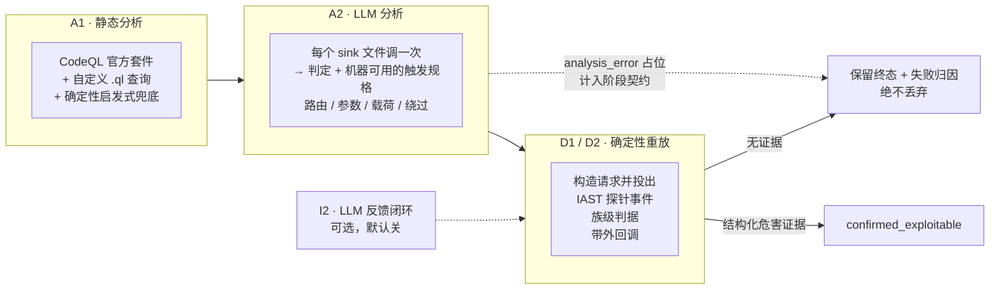

<div align="center">

# SAVR

**S**can · **A**nalyze · **V**erify · **R**eplay（扫描 · 分析 · 验证 · 重放）

自动化白盒漏洞扫描与验证流水线：静态分析产生候选告警，大模型给出研判与机器可用的触发规格；
确定性重放对运行中的目标发起验证，告警是否成立仅由结构化危害证据判定。
模型不接触目标，验证过程确定、可复现、可审计。

[](https://github.com/sanjio3/SAVR/actions/workflows/ci.yml)
[](LICENSE)
[](pyproject.toml)
[](probe-java/)

[Releases](https://github.com/sanjio3/SAVR/releases) · [Issues](https://github.com/sanjio3/SAVR/issues) ·
[安全公告](https://github.com/sanjio3/SAVR/security/advisories)

[English](README.md) | 中文

</div>

---

## 扫描流程



- A1 跑 CodeQL 官方套件，加上针对官方查询不建模形态的自定义查询（`prepareCall`、Spring `JdbcTemplate`、弱哈希算法），并带一条确定性的启发式兜底，保证 CodeQL 建库失败不会静默产出一份空报告。
- A2 每个 sink 文件调一次 LLM，同时返回判定和机器可用的触发规格，经 JSON 校验并带一轮修复。失败的文件记为 `analysis_error` 占位并在阶段契约里计数，绝不丢弃——因为被丢掉的文件和本来就干净的文件，在最终报告里长得一模一样。
- D1/D2 执行重放。确认必须有结构化危害证据：sink 上的探针事件、族级判据（SQL 布尔对、路径穿越文件特征、表达式求值、反射），或带外回调。「到达 sink」和「模型说有害」这两者本身都不够。
- 未确认的候选保留终态与失败归因，因此「漏了一个漏洞」和「靶场挂了」「端点在 404」「载荷没送到」可以区分开。
- 确定性重跑始终开启。I2 是一个根据重放差分重新判定的 LLM 反馈闭环，需要显式开启（`SAST_AI_CLOSED_LOOP=1`），在我们的测试中未出现过增益。

时间花在哪里，是我们自己实测的：95 个文件的 Java 靶场上，重放与靶场往返占记录阶段时间的 45%，LLM 阶段 26%，确定性重跑 25%，静态分析 2%。130 例基准分片上分别是 46% / 18% / 16% / 17%。主要成本是打靶场，不是推理。

---

## 检测效果

报告三套评测集。它们的记账口径不同，不能合并成一个分数。这些数字描述的是在参考靶场上的一次一致性运行，不是靶场无关的保证。

### Java 靶场，四档口径

对一个公开的 Java 漏洞测试应用做全量重扫（31 个 in_scope 真值点）。动态分母是 24 个点：31 减去 4 个物理不可达端点，再减去 3 个无法靠投载荷证明的属性/配置族。

`confirmed_replay` 要求 `verification_status == confirmed_exploitable`、证据规则不带 `framework:` 前缀、且该规格在 `replay_attempts` 里至少有一行。

| 轮次 | 差异 | 静态（文件级） | 静态（文件+族） | 重放（文件+族） | 红线误报 |
|---|---|---|---|---|---|
| 基线 | 冻结构建，全量重扫 | 31/31 | 30/31 | 24/24 | 0/65 |
| 路由盲化 | 路由名与分发目标重写 | 30/31 | 29/31 | 21/24（87.5%） | 0/40 |
| 稳定性 A | 相同配置，第二次运行 | 31/31 | 30/31 | 24/24 | 1/62 |
| 稳定性 B | 相同配置，第三次运行 | 31/31 | 30/31 | 23/24（95.8%） | 0/62 |

- 稳定性是量出来的，不是假设的。同一份冻结源码、相同配置连跑两次，得到 24/24 和 23/24，一个点的抖动。变动的那一点是一个 SSTI 用例，它的迟到值级证据一次运行来了、一次没来。不要把它写成「稳定在 100%」。
- 盲化路由名要付出 4 个点的静态文件+族召回和 12.5 个点的重放召回。这个差距就是「知道路由叫什么」的实测价值，也是我们把路由名启发式当作先验而不是证据的原因。
- 稳定性 A 里那一条红线，是一个真实的反射 XSS，只是随仓库分发的真值表没有为那个文件登记。我们选择如实披露，而不是改真值表把它吸收掉。按 2026 年之前更宽松的定义，路由盲化那轮也会读出 1 条红线；是收紧定义（要求真有一次重放尝试）让它变成 0 的，这不是修复，我们就是这么标注的。
- 三轮未盲化的运行里，静态文件+族都是 30/31，缺的始终是同一个点。那是已知的覆盖缺口，不是轮次间噪声。

用你自己的扫描数据库复算：

```bash
python tools/jsc_four_tier.py --task-id <id> --verbose
python tools/jsc_four_tier.py --task-id <id> --param-drift
python tools/generalization_compare.py --mode stability --baseline <id1> --variant <id2>
```

### 跨靶场基线（RuoYi 4.5.1）

另一套真值表（15 行，6 行 in_scope），另一个框架和另一份代码。静态 4/4（按行 6/6）、动态 4/4（6/6）、运行时重放 2/4（2/6）、红线误报 0/2、确认级误报 0/7。四个未确认点里，三个是 MyBatis `${}` 已按静态代码属性确认、但布尔盲注判据条件不成立，一个是到达 sink 但没判出危害。这四个没有一个是漏检。

这一轮只建基线，不与 Java 靶场的 24 点分母比大小，因为两张真值表的规模和族都不同。

### OWASP Benchmark，130 例分片

79 个真阳性、51 个假阳性，按用例逐条对齐官方 `expectedresults-1.2.csv`。

这个基准存在两套口径，不可互换。早期工作用的是严格重放定义出现之前的确认态记账，那些数字依赖路由布局先验。保留它们只是因为两者之间的差距有信息量：

| 口径 | TP | FP | 召回 | 精确率 |
|---|---|---|---|---|
| 早期口径，常规布局，布局先验开 | 78 | 0 | 98.7% | 100% |
| 早期口径，布局盲化，布局先验关 | 71 | 0 | 89.9% | 100% |

那 8.9 个百分点就是对 URL 布局知识的实测依赖度：产出第二行时重命名了 2740 条路由并重写了分发目标。两行都早于严格重放定义，与下面的数字不可比。

同样 130 例上的当前读数：确认 59 个用例，59 TP、0 FP、精确率 100%、召回 74.7%、红线误报 0/34。

零假确认加 74.7% 召回，才是诚实的总结。它不是「全部检出」。漏掉的 20 个真阳性拆开是弱随机 15、弱哈希 2、SQL 注入 2、弱加密 1。其中弱随机整族 0/15：那些是真实缺陷，扫描器也检出了，但确认阶段目前证明不了，因为它们的规格被标成 `xss` 并被路由进 XSS 判决通道。详见下面「现在不足」。

红线通过的意思是「我们没有把假漏洞确认为真漏洞」。它不意味着「我们把所有漏洞都找出来了」。

---

## 环境要求

- Python 3.12+
- Node.js 20+（前端）
- JDK 11+ 与 Maven（构建 IAST 探针；探针是构建产物，不随仓库分发）
- CodeQL CLI（静态分析阶段用）。`uv run python scripts/fetch_tools.py --dest tools --only codeql` 会把 bundle 解包到 `tools/codeql/`；也可以设 `CODEQL_BIN`，或把 `codeql` 放进 `PATH`。bundle 约 1GB，不入库。
- 本地 LLM，由 Ollama 提供（默认 `qwen3:8b`），或任何 OpenAI 兼容端点
- 一个运行中的 HTTP 靶场，并挂载本项目自带的 IAST java agent。靶场应用、JDK、Tomcat 与第三方二进制不在本仓库内分发，需要你自己提供

主开发平台是 Windows。Linux 与 macOS 理论可用但未实测。

---

## 安装

```bash
git clone https://github.com/sanjio3/SAVR.git && cd SAVR
uv sync --frozen --group dev
cp .env.example .env
uv run python scripts/fetch_tools.py --dest tools --only codeql
ollama pull qwen3:8b
uv run python -m src.cli.service_server
```

`uv.lock` 锁定全部依赖，`pyproject.toml` 是权威声明。仓库根目录就是导入根，不需要安装成包。本文档里的命令统一用 `uv run`；把虚拟环境加进 `PATH` 后直接调 `python` 也可以。

后端监听 `127.0.0.1:8000`。前端单独跑：`cd frontend && npm ci && npm run dev`，监听 `127.0.0.1:5173`。

---

## 第一次运行

### 构建探针

IAST 探针是构建产物，不随仓库分发；源码在 `probe-java/`。需要 JDK 11 与 Maven：

```bash
mvn -B -DskipTests -f probe-java/pom.xml clean package
jar cf probe-java/target/sec-probe-bootstrap.jar -C probe-java/target/classes com/rasp/probe/TaintHub.class
```

第一条产出 `sec-probe.jar`（探针主体），第二条产出 `sec-probe-bootstrap.jar`。后者只含
`TaintHub` 一个类，必须放进 `-Xbootclasspath/a`：探针要在 JDK 类加载器启动之前就能看到它，
否则 bootstrap 期的插桩拿不到共享状态。**两条命令都要跑，`mvn` 不会自动生成 bootstrap jar。**
构建前先停掉靶场 JVM，否则 jar 被占用无法覆盖。

挂载参数如下（取自 `scripts/launch/launch_java_quote.py`，可直接照拄）：

```bash
java -Xbootclasspath/a:probe-java/target/sec-probe-bootstrap.jar \
     -javaagent:probe-java/target/sec-probe.jar \
     -Dsec.server.url=http://127.0.0.1:8000 \
     -Dsec.agent.id=<agent-id> \
     -Dsec.app.name=<app-name> \
     -Dsec.agent.token=<DB 里的 probe_token> \
     -Dsec.app.packages=<你的业务包前缀，如 com.example> \
     -Dsec.network.timeout.ms=5000 \
     -jar your-target.jar
```

四个必须对的点：

- `-Dsec.app.packages` 写**真实业务包前缀**。写错不会报错，只是零插桩、一个事件都没有，
  这是最常见的「扫描跑完了但什么都没发现」。
- `-Dsec.server.url` 用 `127.0.0.1` 而不是 `localhost`。后者在部分环境解析到 `::1`，
  而后端只监听 IPv4。
- `-Dsec.agent.token` 必须与数据库 `iast_sessions.probe_token` 一致。不一致时摄取接口
  返回 HTTP 200 且 `accepted=0`，看起来像成功。
- 探针只能在 JVM **启动前**挂载，不支持运行时 attach。

挂完先自检，`ready=true` 才算接上：

```bash
python tools/probe_preflight.py --workspace-id <id> --http
```

它同时校验会话行存在、心跳新鲜、`X-Agent-Token` 握手被接受且返回非空 `session_id`。
它不写事件、不刷新心跳，所以不会把已经死掉的心跳伪装成活的。

### 接入你自己的靶场

本仓库不分发任何靶场源码，也不绑定特定靶场。接入方式是写一个启动脚本，把探针按上面的
参数挂到你自己的应用上。`scripts/launch/launch_java_quote.py` 是最小完整示例：它起一个
Spring Boot 应用、解析探针 jar 路径、从数据库取 token、拼好 JVM 参数。照它改成你的启动
命令即可。

`scripts/launch/launch_stack.py` 启动的是 SAVR 自己（后端 + 前端看门狗），与靶场无关。

两个环境变量有用：`SAST_AI_PROBE_JAR` 改写探针 jar 路径，`SAST_AI_TOOLS_DIR` 指向
`scripts/fetch_tools.py` 下载第三方工具的目录。

### 提交一次扫描

注册一个指向靶场的工作区、挂上探针，通过 API 或界面提交任务。调试用的 CLI 入口是：

```bash
python -m src.cli.scan_task_runner --task-id 1 --target /path/to/target/src \
  --output-dir output/run1 --no-sca
```

`--shard-file <path>` 可选：指向一个 JSON 分片清单，把扫描范围收窄到清单内的入口；
不给就扫全量。分片清单的格式见 `src/core/scan_scope.py` 的加载逻辑。

在把一轮指向外部靶场之前，先确认探针会话与 token 确实对得上。对不上时，摄取接口会返回 HTTP 200 且 `accepted=0`，很容易被误读成成功：

```bash
python tools/probe_preflight.py --workspace-id 4 --http
```

`ready=true` 表示会话行存在、心跳新鲜，且带 `X-Agent-Token` 的握手被接受并返回了非空 `session_id` 且无 `errors`。这个检查不写任何事件，也不刷新心跳，所以它不会把已经死掉的心跳弄成活着的。

---

## 配置

配置以环境变量优先。`.env.example` 列出核心运行键及其默认值；模型超参在 `config/model_capabilities.yaml`。

选模型三步：

1. `cp config/config.example.yaml config.yaml`。该副本被 gitignore 排除，因为它可能存放凭据。
2. 把 `api.provider` 与 `api.model` 指向样例里的某个段：`ollama`（默认，不需密钥）、`qwen`、`doubao`、`minimax`、`deepseek`、`openai-compatible`、`claude`、`anthropic-compatible`。
3. 填该段。本地 `ollama` 只需 `base_url` 与 `model`；云端段需 `base_url`、`api_key`、`model`。任何值都可以写成 `"${ENV_VAR}"`，让密钥留在环境变量里。

不要提交 `.env`、`config.yaml` 或任何数据库。

环境变量沿用项目早期名称的 `SAST_AI_` 前缀。这个前缀属于运行契约的一部分——基线 6 项 `run_env` 里有两项就是用这个前缀拼的——因此刻意保持不变，以维持向后兼容。

### 决定一轮是否有效的键

- `SAST_AI_STAGE_CACHE=0`：可计量的一轮必须显式关闭阶段缓存。代码默认是 `1`，否则缓存的 A1/A2 输出会掩盖轮次间的差异。
- `SAST_AI_CLOSED_LOOP=0`：除非你特意要 I2 反馈闭环，否则保持关闭。它没有实测增益，而且会给确认路径加上一层 LLM 依赖。
- `SAST_AI_BENCHMARK_PRIOR=1`：保持路由布局先验开启。关掉它才是那个「召回有多少依赖路由名」的实验。

---

## 仓库结构

```
SAVR/
├── src/                     # 后端：agents、流水线、IAST 桥接、CLI
│   ├── agents/              # A1 静态、A2 LLM 分析、D2 执行器
│   ├── pipeline/            # a1 / a2 / d2 阶段契约
│   ├── iast/                # 探针摄取、覆盖率、族级判据
│   ├── core/                # 共享原语：配置、族映射、阶段缓存
│   └── cli/                 # 服务端、扫描任务执行器、基准 CLI
├── probe-java/              # IAST/RASP 探针（Java + ByteBuddy）—— 构建产物，不随仓库分发
├── frontend/                # Vue 3 + Vite 控制台
├── tools/                   # 对账、分片、评估工具、一次性脚本
├── scripts/                 # 入口：fetch_tools、submit_scan_task、launch/
├── config/                  # 随仓库分发、不含凭据的配置
├── data/                    # 参考真值表与分片清单
├── tests/                   # 单元与回归测试
└── .github/workflows/       # CI 三项必需检查与 benchmark 手动重跑
```

---

## 提 issue

先跑这两个检查，它们能解决很大一部分报告：

1. `python tools/probe_preflight.py --workspace-id <id> --http` —— 如果不是 `ready=true`，事件正在被丢弃，每次重放都会看起来像漏检。
2. `uv run --frozen python tools/ci_gate.py` —— 确认问题不是本机环境造成的。

开 issue 时请附上：

- 你期望什么、实际发生了什么，一两句话。
- 用的模型与提供方（通过 Ollama 的 `qwen3:8b`，或你自己的端点）、靶场应用、探针怎么挂的，以及你设了哪些 `run_env` 键。
- 该规格的终态 `verification_status` 与 `failure_attribution`，若涉及 LLM 阶段再加上 `stage_results.a2.contract`。这三个字段能解释大部分漏检，不需要对方看源码。
- 相关日志行，不是整份日志。

## 许可

Apache License 2.0。完整条款见 [LICENSE](LICENSE)；第三方组件的署名声明见 [NOTICE](NOTICE)。

该许可允许使用、修改与再分发，包括用于闭源产品，前提是保留版权与许可声明、标明所做修改，且不得用项目名或贡献者姓名为衍生作品背书。许可中包含贡献者给出的明示专利授权。

选择宽松许可是刻意的：本工具的定位是被嵌入既有安全流水线，而非独立使用。
